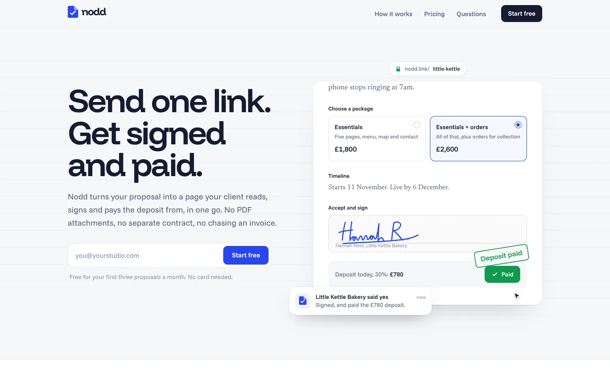
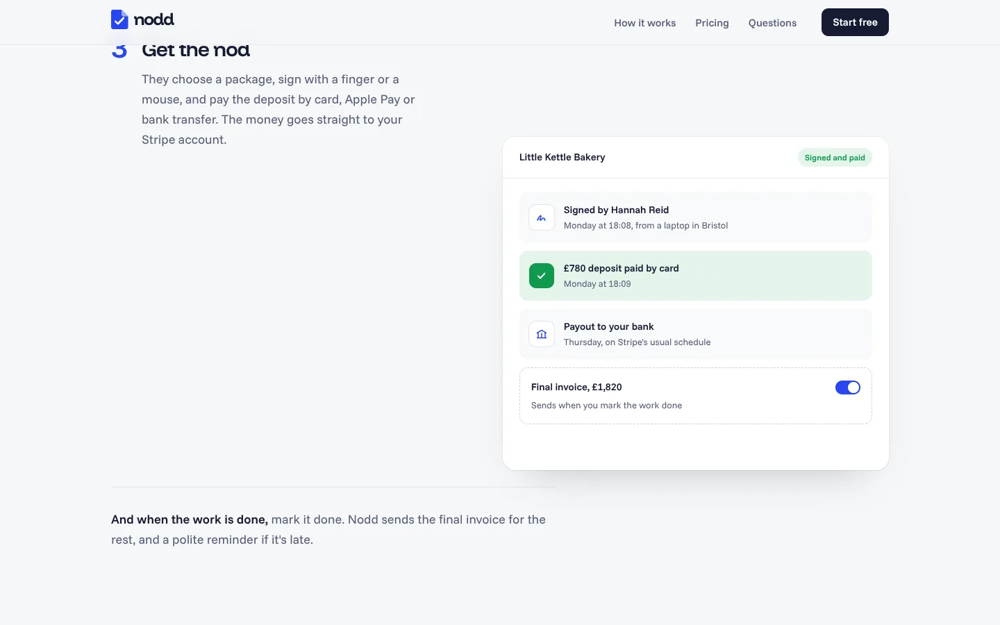
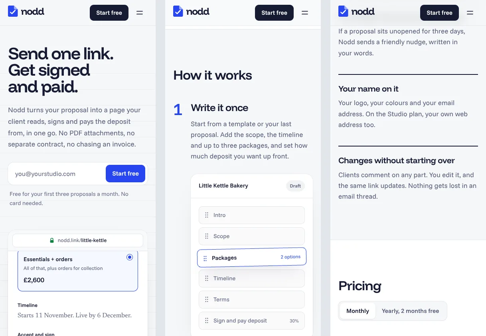

# Nodd

A landing page for Nodd, a proposal tool for freelancers and small studios: one link where the client reads the proposal, picks a package, signs and pays the deposit. Built with Next.js and Tailwind CSS.

**Live:** [nodd-bay.vercel.app](https://nodd-bay.vercel.app/)



> Nodd is a made-up product. The page is real: the sign-up form checks the email and then says plainly that nothing was saved, and the page asks search engines not to index it.
>
> Designed and built by Alexandra Badea · [Pages by Alexa](https://pagesbyalexa.com)

## What's on the page

- **A live proposal in the opening.** Built in code, not a screenshot: the client picks the bigger package, the deposit updates, the signature is drawn in ink, the deposit is paid and the freelancer gets told. It starts once the page has loaded, plays only while it's on screen, and has a pause button. For anyone who has turned motion off it shows the finished, paid proposal instead.
- **The usual way next to Nodd,** told as a week of emails rather than statistics.
- **How it works** in three steps. On large screens the product picture stays put and changes as you scroll; on phones each step carries its own. Each picture plays its moment the first time you reach it: the block moving into place, the activity arriving, the deposit turning green.
- **The details,** pricing with a monthly and yearly switch, questions, and a closing sign-up.
- **A not-found page** in the same style.





## Design

Stationery rather than the usual SaaS look: cool paper, iron-gall ink for text, a blue signing pen for anything you click, highlighter yellow for marks on documents, and green only for money that has landed. Headings and text are in Funnel Display and Funnel Sans; the proposal inside the product pictures is set in Newsreader, so it reads like a real document.

There is one moving centrepiece, the proposal in the opening. Everything else moves only when you do something: scrolling through the steps, switching the billing period, opening a question.

## Checked

- Every width from 320px to 2560px and 18 real device sizes, phones held either way, with no sideways scrolling, clipped text or phones zooming out. Past 1920px the page scales up, so big monitors see the same composition as a laptop.
- Lighthouse on a phone: performance 95+, accessibility 100, best practices 100. On desktop: 100 for all three. (SEO scores lower on purpose: the page asks search engines not to index a made-up product.)
- Keyboard focus is always visible, colours pass contrast for their text sizes, and the page works with motion turned off.

## Run it

You need Node 20 or newer.

```bash
npm install
npm run dev
```

Open http://localhost:3000.

| Command | What it does |
|---|---|
| `npm run dev` | Development server |
| `npm run build` / `npm start` | Production build and server |
| `npm run lint` | ESLint |
| `npm run typecheck` | TypeScript, without building |

To deploy, import the repository on [vercel.com/new](https://vercel.com/new). There's nothing to configure.

## Where things are

```
src/
  app/                 the page, the not-found page, fonts, colours and the social preview
  components/
    hero-demo.tsx      the proposal that signs and pays itself
    how-it-works.tsx   the three steps and their pictures
    pricing.tsx        plans with the monthly and yearly switch
    start-form.tsx     the sign-up box
  fonts/               self-hosted fonts and their licence
```

## Copyright

© 2026 Alexandra Badea. All rights reserved: the code is public to read, but please ask before reusing it. The fonts (Funnel Display, Funnel Sans and Newsreader) are under the SIL Open Font License; see `src/fonts/OFL.txt`.
